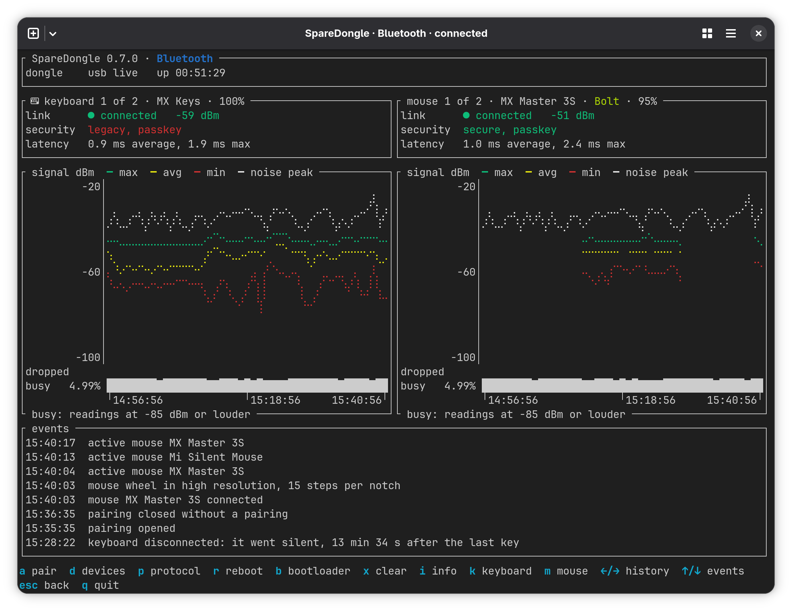

# SpareDongle

An open USB receiver for wireless keyboards and mice, for when the original receiver is lost or not
good enough, running on a [Pro Micro nRF52840](#hardware). It supports NuPhy 2.4G on NuPhy's QMK
keyboards, Logitech Unifying keyboards and Bluetooth LE keyboards and mice, one at a time;
[Protocols](#protocols) lists what each supports and how it compares. The keyboard keeps its own
firmware.

Compared with NuPhy's own dongle it drops no valid keyboard report, and in NuPhy and Unifying
mode it moves the link away from Wi-Fi noise. In Bluetooth mode it holds a keyboard and a mouse
from different makers, such as the Air75 V2 with the MX Master 3S, where each maker's receiver
takes only its own devices. Compared with the PC's Bluetooth it works in boot menus and moves to
another PC with the dongle. Its tool shows each device's signal and losses, and in NuPhy and
Unifying mode the radio noise.

<p align="center">
  
</p>

The `spare-dongle` live view, here in Bluetooth mode with two keyboards and two mice connected,
showing the MX Keys and the MX Master 3S used last: each device's signal over time, its latency
through the dongle, and the dongle's events.

## Protocols

| Protocol | Support | Security |
|---|---|---|
| NuPhy 2.4G, QMK keyboards | [🟢 full](docs/nuphy.md) | [❌ no protection](docs/nuphy.md#security) |
| Logi Bolt | [🟡 partial](docs/bolt.md): Bolt mice, in Bluetooth mode | [🟢 safe even during pairing](docs/bolt.md#security) |
| Bluetooth LE | [🟡 partial](docs/bluetooth.md): up to four devices at once | [🔴 to 🟢, by how the device paired](docs/bluetooth.md#security) |
| Logitech Unifying | [🟡 partial](docs/unifying.md): up to six keyboards, one at a time | [🔴 weak at any time](docs/unifying.md#security) |
| NuPhy 2.4G, NuPhyIO keyboards | 🔴 none yet | ❌ no protection |
| Bluetooth Classic | ❌ not supported: the nRF52840 has no Classic radio | 🔴 to 🟢, by how the device paired |

Support is compared with the original receiver, or for Bluetooth the PC's own.

One firmware speaks NuPhy, Unifying and Bluetooth LE, but only one runs at a time, chosen by a
setting the dongle keeps in flash. A new dongle runs Bluetooth. `spare-dongle protocol nuphy`,
`unifying` or `bluetooth` switches it, and the dongle reboots into the new protocol. Each protocol
keeps its own pairing, so switching back needs no new pairing.

## Hardware

- A Pro Micro nRF52840, often sold as a nice!nano clone.
- A USB-C cable to the PC.
- Optionally, the [printed case](enclosure/README.md).

No soldering is needed. The board needs the Adafruit UF2 bootloader on SoftDevice S140 6.x. New
boards ship with it under a factory program, which [`spare-dongle flash`](#flashing-the-firmware)
replaces.

Only the Pro Micro has been tested. A nice!nano or another clone with the same bootloader should
work. Other nRF52840 boards need their own Zephyr board target, and `spare-dongle flash`
and the udev rule recognize only this bootloader.

The dongle is a standard USB keyboard and mouse, so it needs no driver; it has been used on Linux,
macOS and Windows.

<p align="center">
  
</p>

## Installing the tool

`spare-dongle` flashes the dongle and reads its [diagnostics](#diagnostics). It runs on x86_64 Linux,
Apple Silicon macOS and x86_64 Windows. To install the latest release into `~/.local/bin`, or into
`PREFIX` when it is set:

```
curl -fsSL https://raw.githubusercontent.com/valeronm/spare-dongle/main/tools/get.sh | sh
```

The installer also saves the release's firmware in `~/.local/share/spare-dongle` and offers to
[flash](#flashing-the-firmware) it onto a plugged-in dongle or board.

On Windows, download `spare-dongle-<version>-x86_64-windows.zip` from the
[latest release](https://github.com/valeronm/spare-dongle/releases/latest), unzip it and run
`spare-dongle.exe` from a terminal.

On Linux, a udev rule lets the tool reach the board without root in every state
[`spare-dongle flash`](#flashing-the-firmware) handles. The installer offers to install it with
sudo and leaves it in `~/.local/share/spare-dongle`, and a source checkout has it in `tools/udev`.
To install it by hand and apply it to a board that is already plugged in:

```
sudo cp ~/.local/share/spare-dongle/70-spare-dongle.rules /etc/udev/rules.d/
sudo udevadm control --reload
sudo udevadm trigger --subsystem-match=hidraw --subsystem-match=tty
```

## Flashing the firmware

Running the [installer](#installing-the-tool) again installs the latest tool and offers to flash its
firmware. Or download the `.uf2` from the
[latest release](https://github.com/valeronm/spare-dongle/releases/latest) and run:

```
spare-dongle flash spare-dongle-<version>-promicro_nrf52840.uf2
```

`spare-dongle flash` writes firmware to a running dongle, to a board in its bootloader, or to a new
board still running its factory program, restarting it into the bootloader as needed. A board
`spare-dongle flash` does not find enters its bootloader when RST is shorted to GND twice quickly.
Changes between releases are in [CHANGELOG.md](CHANGELOG.md).

### Firmware updates

The board's UF2 bootloader accepts any image, and a diagnostic command restarts the dongle into it
over USB. Any program that can open the dongle's diagnostic interface, or anyone who plugs the
dongle into their own computer, can replace its firmware, including with one that reads the stored
Unifying link key or Bluetooth bond keys.

## Pairing

`spare-dongle pair`, or `a` in the live view, opens pairing for 30 seconds, or 60 in Bluetooth
mode. Plugging the dongle in opens nothing. A device that starts pairing keeps it open until it
pairs or fails, and a failed attempt closes pairing.

A connected NuPhy keyboard keeps `spare-dongle pair` from hearing another one, so switch it off
first.
In NuPhy mode a new keyboard replaces the one paired before; in Unifying mode it takes a free place.

**NuPhy:** in 2.4G mode, hold Fn+4 for 3 seconds. Keep the keyboard close, since it transmits at
low power while pairing. If the link gets worse after the Wi-Fi around you changes, pair again.

**Unifying:** switch the keyboard off and on. On a keyboard with Easy-Switch keys, such as the MX
Keys, first hold an Easy-Switch key until it blinks fast.

**Bluetooth:** the dongle keeps up to four keyboards and mice connected at once and passes on the
input of each. Run `spare-dongle pair` and put the keyboard or mouse in Bluetooth pairing mode. The
tool lists the devices it hears in pairing mode, each keeping its number; type the number of yours.
If the device asks for a passkey, the tool prints six digits to type on the keyboard and press
Enter, or for a Logi Bolt mouse ten clicks. A keyboard with no passkey step, such as the Air75 V2,
and most mice pair without one. Running `pair` again after a failed attempt gives a new passkey.
Opening pairing keeps the connected devices, and a device that pairs with four connected takes the
place of the one used longest ago, never the keyboard or mouse used last.
[docs/tool.md](docs/tool.md#bluetooth-mode) covers the stored devices.

## LED

| LED | Meaning |
|-----|---------|
| short flash every second | nothing connected |
| fast blink | pairing is open |
| solid | a keyboard or a mouse is connected |
| off | the PC has suspended USB |
| three flashes every two seconds | the radio failed to start |

## Diagnostics

`spare-dongle` reads the dongle's link state and signal, counters, history, events and radio noise
over USB, in a live view or one command at a time. [docs/tool.md](docs/tool.md) describes what it
shows and every command.

## Building from source

- [mise](https://mise.jdx.dev), which installs Rust, CMake, Ninja, Python and uv at the versions in
  `mise.toml`.
- A C compiler, for the tests.
- On macOS, the Xcode command line tools and `dtc` (for example `brew install dtc`).

In the clone:

```
mise trust
mise install
mise run setup
```

`mise run setup` downloads the nRF Connect SDK release named in `mise.toml` and the Zephyr SDK it
requires, about 8 GB, into `~/ncs`, or into `NCS_ROOT` when it is set. It skips what is already in
place, so it is safe to rerun. The ESB library and the USB device stack change their APIs between
SDK releases, so other versions are untested.

On Linux, install the [udev rule](#installing-the-tool) from `tools/udev` before flashing.

```
mise run build
mise run flash [serial]
cargo install --locked --path tool
```

`mise run build` first applies the Zephyr fixes in `patches/zephyr` to the SDK, those not already
in it, and stops when one no longer applies. `mise run flash` flashes the image it wrote.

## Development

`mise run test` runs the firmware modules' tests on the host and the tool's tests. It does not need
the SDKs. `mise run lint` runs rustfmt, clippy and shellcheck. CI runs both on `main` and on pull
requests.

Each protocol page's On air section describes the link beyond what the code shows:
[NuPhy](docs/nuphy.md#on-air), [Unifying](docs/unifying.md#on-air),
[Bluetooth](docs/bluetooth.md#on-air) and [Logi Bolt](docs/bolt.md#on-air).

A release is built when a `v<version>` tag is pushed. Set the version in `tool/Cargo.toml`, which
the firmware reads too, add its section to `CHANGELOG.md`, commit, and push the tag. The release
fails when the tag, the version and the changelog disagree.

## License and trademarks

SpareDongle is under the [MIT License](LICENSE). The firmware builds on the nRF Connect SDK and
Zephyr, which carry their own licenses.

SpareDongle is not affiliated with or endorsed by NuPhy, Logitech, Nordic Semiconductor or the
Bluetooth SIG. Product and company names in this repository are trademarks of their owners, used
only to say what SpareDongle works with.
